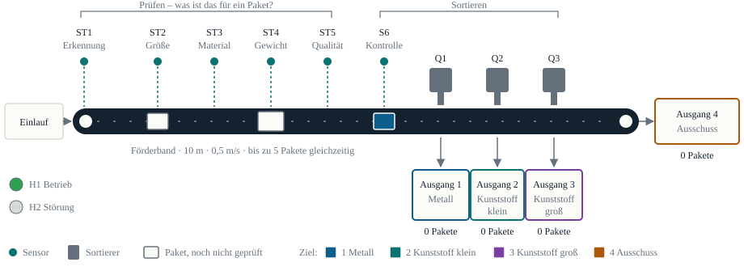
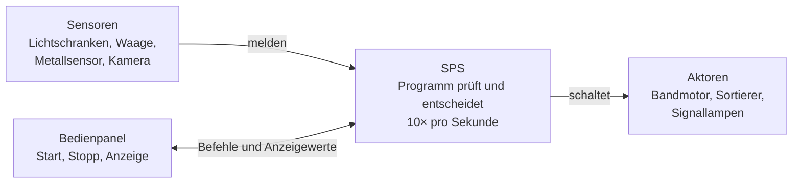
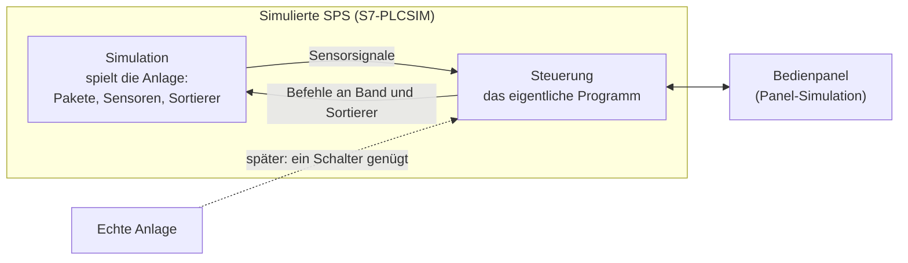
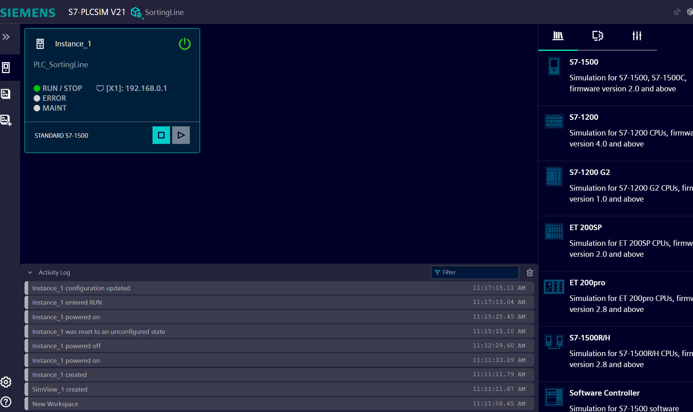
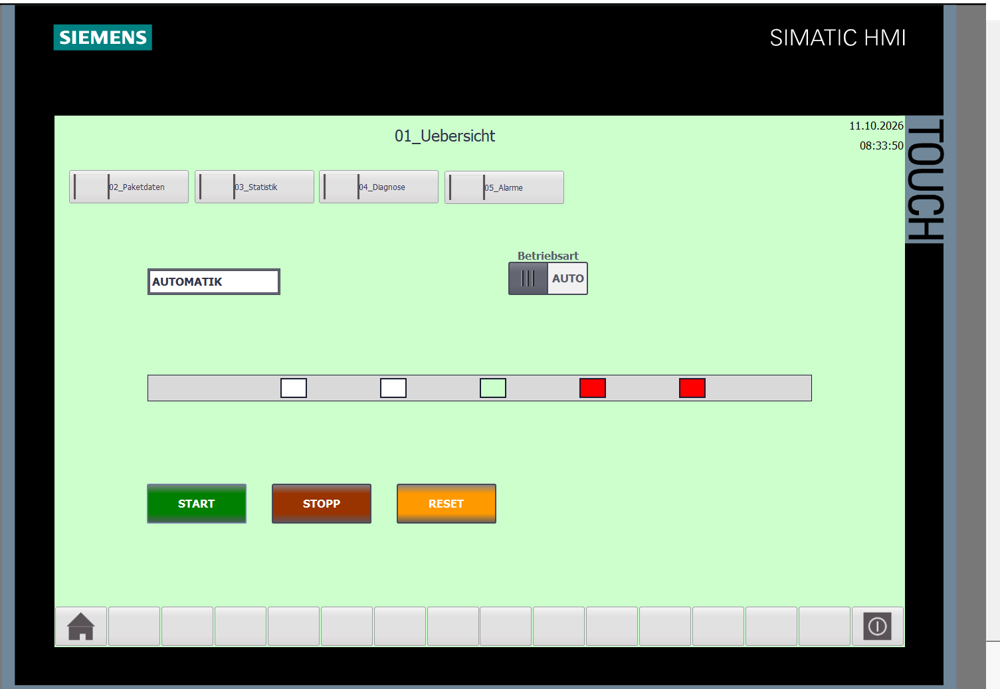
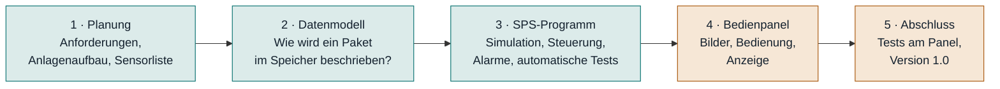
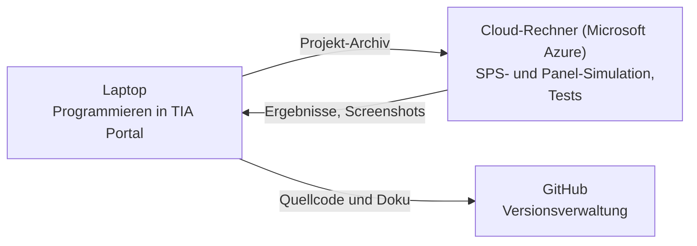
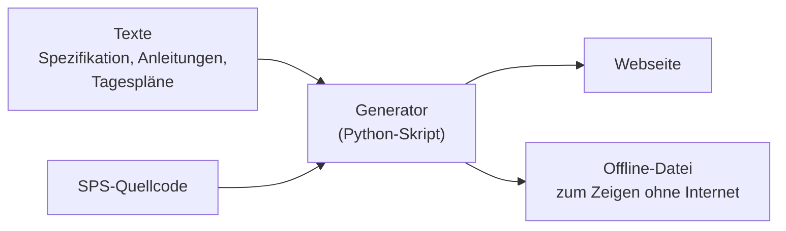

# Einführung in das Projekt

Diese Seite erklärt das Projekt in einfachen Worten, ohne SPS-Vorwissen. Die technischen Einzelheiten stehen in den folgenden Kapiteln.

## In einem Satz

Ein **Steuerungsprogramm für eine Paket-Sortieranlage**, wie sie in Logistikzentren steht. Die Anlage prüft jedes Paket, entscheidet, wohin es gehört, und schiebt es automatisch in den richtigen Ausgang. Programmiert ist sie mit dem Industriestandard **Siemens S7 / TIA Portal**. Getestet wird vollständig in der **Simulation**, also ohne teure Hardware.

## Was macht die Anlage?

<figure>

<figcaption>Die Anlage von oben: Pakete laufen von links nach rechts über das Band, werden geprüft und sortiert.</figcaption>
</figure>

Pakete kommen nacheinander auf ein 10 m langes Förderband. Unterwegs passieren sie fünf Prüfstationen:

1. **Erkennung:** Ein neues Paket ist da und bekommt eine Nummer.
2. **Größe:** klein oder groß?
3. **Material:** Metall oder Kunststoff?
4. **Gewicht:** Eine Waage misst das Gewicht.
5. **Qualität:** in Ordnung oder beschädigt?

Danach steht fest, wohin das Paket gehört. Ein **Sortierer** (ein Druckluftzylinder) schiebt es im richtigen Moment vom Band in eine Rutsche:

| Paket | landet in |
|---|---|
| Metall | Ausgang 1 |
| Kunststoff, klein | Ausgang 2 |
| Kunststoff, groß | Ausgang 3 |
| beschädigt, zu leicht oder zu schwer | Ausgang 4 – Ausschuss, am Bandende |

**Beispiel:** Ein Metallpaket mit 1,2 kg, in Ordnung:

- Nach 5 s wird es als „Metall“ erkannt.
- Nach 9 s steht das Ziel fest.
- Nach 12,6 s schiebt Sortierer Q1 es in Ausgang 1.
- Nach 13,3 s meldet die Lichtschranke in der Rutsche die Ankunft.

Gleichzeitig können bis zu **fünf Pakete** auf dem Band sein. Die Steuerung verfolgt jedes einzeln.

Dazu kommt, was eine echte Anlage braucht:

- **Betriebsarten:** Automatik und Handbetrieb, Not-Halt
- **Störungen erkennen:** Sortierer klemmt, Sensor defekt, Paket verloren. Die Anlage reagiert, meldet einen Alarm und wartet auf Quittierung.
- **Statistik:** Anzahl je Ausgang, Ausschussquote, Durchsatz
- **Bedienpanel:** ein Touch-Bildschirm, auf dem man die Anlage sieht und bedient

## Wie arbeitet die Steuerung?

Das Herz ist eine **SPS** (speicherprogrammierbare Steuerung), ein robuster Industrierechner. Er arbeitet immer nach demselben Muster: **Eingänge lesen – entscheiden – Ausgänge schalten**. Das wiederholt er **zehnmal pro Sekunde**.

Das Programm ist in **Bausteine** aufgeteilt, wie ein Team mit klaren Zuständigkeiten. Ein Baustein verfolgt die Pakete, einer steuert die Sortierer, einer kümmert sich um Alarme, einer um die Statistik. Ein Hauptbaustein ruft sie in fester Reihenfolge auf. So bleibt das Programm übersichtlich, und jeder Teil lässt sich einzeln prüfen.

## Wie geht das ohne echte Anlage?

Eine echte Sortieranlage kostet viel Geld und Platz. Deshalb **spielt ein Teil des Programms die Anlage selbst**: Er bewegt virtuelle Pakete über das Band und erzeugt daraus die Sensorsignale, die eine echte Anlage liefern würde. Für die eigentliche Steuerung sieht das aus wie echte Hardware.

Mit einem einzigen Umschalter würde die Steuerung statt der Simulation echte Ein- und Ausgänge verwenden. Das Steuerungsprogramm selbst bleibt dabei unverändert.

Die Simulation kann außerdem gezielt **Fehler einbauen**: ein klemmender Sortierer, ein defekter Sensor, ein Not-Halt. So lässt sich prüfen, ob die Steuerung richtig reagiert, ohne etwas kaputt zu machen.

## Wie wurde getestet?

Getestet wird nicht von Hand, sondern **automatisch**. Ein Testprogramm in der SPS spielt 13 Situationen nacheinander durch und prüft jedes Ergebnis:

- 8 Sortierfälle, darunter die Grenzwerte 0,5 kg und 5,0 kg
- volles Band mit 5 Paketen: das sechste muss warten
- klemmender und blockierter Sortierer, defekter Sensor, Not-Halt im Handbetrieb

Das Ergebnis: **13 von 13 Tests bestanden**. Jeder Schritt wird protokolliert, Fehler lassen sich also genau nachvollziehen.

<figure>

<figcaption>Die simulierte SPS läuft (Zustand RUN).</figcaption>
</figure>

## Das Bedienpanel

Auf dem Bedienpanel sieht man die Anlage live: Pakete wandern über das Band, Lampen zeigen den Zustand, Tasten starten und stoppen die Anlage. Weitere Bilder zeigen Paketdaten, Statistik, Diagnose und Alarme.

<figure>

<figcaption>Übersichtsbild auf dem 12-Zoll-Touchpanel TP1200 Comfort, in der Simulation</figcaption>
</figure>

## Wie ist das Projekt entstanden?

Das Projekt ist schrittweise in fünf Phasen aufgebaut, mit einem Tagesplan für jeden Arbeitstag:

| Phase | Ergebnis | Stand |
|---|---|---|
| 1 – Planung | Spezifikation: Was soll die Anlage können? Aufbau, Sensoren, Aktoren, Alarme | abgeschlossen |
| 2 – Datenmodell | Datentypen für Paket, Sortierer, Statistik; Konstanten statt fester Zahlen im Code | abgeschlossen |
| 3 – SPS-Programm | 15 Bausteine, rund 2 200 Zeilen Code, 13 von 13 automatischen Tests bestanden | abgeschlossen |
| 4 – Bedienpanel | Übersichtsbild läuft in der Simulation, weitere Bilder in Arbeit | in Arbeit |
| 5 – Abschluss | Tests am Panel, Dokumentation, Version 1.0 | geplant |

Begonnen wurde mit der **Planung, nicht mit dem Programmieren**: Erst stand fest, was die Anlage können soll und wie sie aufgebaut ist. Erst dann wurde Code geschrieben. Jede Phase wurde abgeschlossen und geprüft, bevor die nächste begann.

## Womit wurde gearbeitet?

| Werkzeug | wofür |
|---|---|
| **Siemens TIA Portal V21** | Programmieren der SPS (Sprache SCL) und des Bedienpanels |
| **S7-PLCSIM** | simulierte SPS, auf der das Programm läuft |
| **WinCC** | Bedienpanel und dessen Simulation |
| **Microsoft Azure** | gemieteter Cloud-Rechner für die Simulation, weil sie auf dem Laptop (ARM-Prozessor) nicht läuft. Er wird nur bei Bedarf eingeschaltet, das hält die Kosten gering. |
| **Git und GitHub** | jede Änderung am Code nachvollziehbar gespeichert |
| **KI-Assistent Claude Code** | Unterstützung beim Schreiben von Code, Tests und Dokumentation |

**Arbeitsteilung:** Projektidee, Entscheidungen, die Arbeit in TIA Portal, die Inbetriebnahme in der Cloud und alle Tests lagen bei Eugenia Funk. Der KI-Assistent hat Vorschläge für Code und Texte geliefert, die in TIA Portal übersetzt und in der Simulation geprüft wurden.

Ein echtes Problem unterwegs: Die SPS-Simulation stürzte auf dem Laptop ab. Die Ursache war der ARM-Prozessor, den Siemens nicht unterstützt. Die Lösung war ein gemieteter Windows-Rechner in der Cloud, der nur bei Bedarf läuft.

## Wie wurde dokumentiert?

Die Dokumentation entsteht **gleichzeitig mit dem Code** und liegt mit ihm zusammen im Repository:

- **Spezifikation** vorab: was die Anlage können soll
- **Tagespläne:** was geplant war, was erledigt ist und was offen bleibt
- **Anleitungen:** Testanleitung, Aufbau des Bedienpanels, Einrichtung des Cloud-Rechners
- **Offene Punkte:** Probleme mit Ursache und Lösung

Diese Webseite wird von einem kleinen Programm **automatisch** aus denselben Dateien erzeugt. Doku und Code können so nicht auseinanderlaufen.

Dazu gibt es eine **Präsentation** mit 17 Folien, auch als vertontes Video mit Computerstimme.

## Was zeigt das Projekt?

| Fähigkeit | wo im Projekt |
|---|---|
| SPS-Programmierung nach Industriestandard | Siemens S7-1500, SCL, TIA Portal V21 |
| Saubere Struktur | Bausteine mit klaren Aufgaben, Datentypen, Konstanten |
| Denken in Abläufen und Zuständen | Paketverfolgung, Sortierer-Ablauf, Betriebsarten |
| Sicherheit und Fehlerbehandlung | Not-Halt, Störungserkennung, Alarme mit Quittierung |
| Testen | 13 automatische Tests mit Protokoll |
| Visualisierung | Bedienpanel mit WinCC |
| Moderne Arbeitsweise | Git, Cloud-Rechner, KI-Unterstützung, Doku als Webseite |

## Kurze Antworten auf typische Fragen

**Warum Simulation statt echter Hardware?**
Weil sie günstig ist und sich Fehler gefahrlos durchspielen lassen. Das Programm ist so gebaut, dass es mit einem Umschalter auch an einer echten Anlage laufen kann.

**Woher weiß man, dass es funktioniert?**
13 automatische Tests decken die Sortierregeln, Grenzwerte und Störfälle ab. Alle 13 sind bestanden. Jeder Testschritt wird protokolliert.

**Was war die größte Schwierigkeit?**
Technisch die Verfolgung von bis zu fünf Paketen gleichzeitig: Jedes muss im richtigen Moment am richtigen Sortierer ankommen. Organisatorisch die Simulation, die auf dem Laptop nicht lief und deshalb in einen Cloud-Rechner umziehen musste.

**Wie geht es weiter?**
Die restlichen Bilder des Bedienpanels, Tests am Panel, dann Version 1.0.
