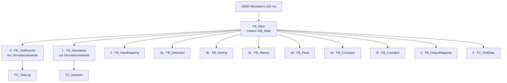
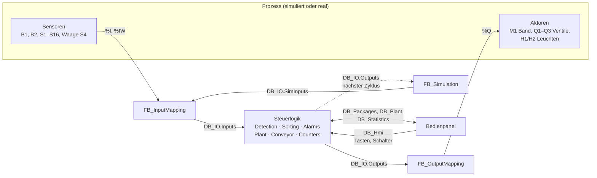
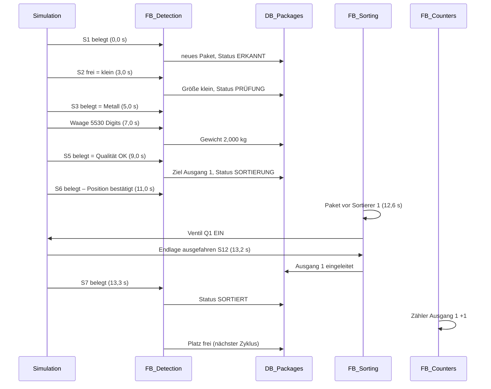
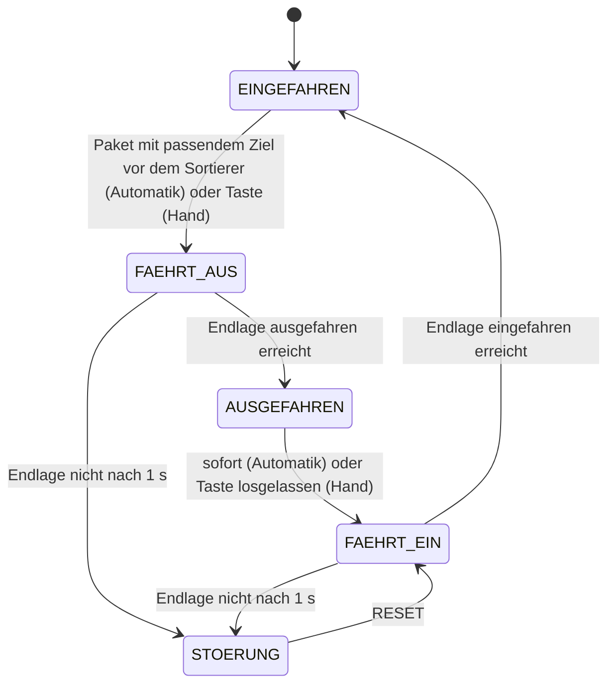

# Programmablaufplan

Wie das SPS-Programm arbeitet: welcher Baustein welchen aufruft, in welcher Reihenfolge die Bausteine in jedem Zyklus laufen, woher sie ihre Daten lesen, wohin sie Zwischenergebnisse und Ergebnisse schreiben, und wie Sensoren und Aktoren angebunden sind.

## 1. Grundprinzip: ein fester Takt

Das gesamte Programm läuft im **Weckalarm OB30 alle 100 ms**. `Main [OB1]` bleibt leer.

- Jeder Durchlauf (Zyklus) führt **alle** Bausteine einmal in **fester Reihenfolge** aus.
- In 100 ms bewegt sich das Band um **0,5 %** seiner Länge (5 cm). Simulation und Paketverfolgung rechnen mit genau diesem Schritt – deshalb bleiben sie synchron.
- Es gibt **keine Wartezeiten** im Programm. Zeiten (Sortierer-Überwachung, Ausgangs-Überwachung, Blinktakt) werden in jedem Zyklus um 100 ms hochgezählt.

## 2. Aufrufhierarchie

Alle Funktionsbausteine sind **Multiinstanzen** in `FB_Main`: Ihre eigenen Merker (zum Beispiel vorherige Sensorzustände für die Flankenerkennung) liegen in `IDB_Main`. Funktionen (FC) haben kein Gedächtnis.

## 3. Ablauf eines Zyklus – wer liest, wer schreibt

| Schritt | Baustein | liest | schreibt |
|---|---|---|---|
| 0 | `FB_TestRunner` | `DB_Test.Start/Abort`, `DB_Plant`, `DB_Packages`, `DB_Statistics`, `DB_Simulation.Packages` | `DB_Simulation` (Einstellungen, Testpaket, Störungen), `DB_Hmi` (Tasten wie ein Bediener), `DB_Test` (Ergebnisse, Protokoll) – arbeitet nur, wenn ein Test läuft |
| 1 | `FB_Simulation` | `DB_IO.Outputs` (aus dem **vorherigen** Zyklus), `DB_Simulation.Settings`, `.ManualPackage`, `.Faults` | `DB_Simulation.Packages` (wahre Pakete), `.Internal` (Kolbenstellungen, Zufallszahl), **`DB_IO.SimInputs`** (Sensorsignale) |
| 2 | `FB_InputMapping` | `DB_IO.SimMode`; je nach Modus `DB_IO.SimInputs` oder die Hardware-Eingänge `%I`/`%IW` | **`DB_IO.Inputs`** – ab hier lesen alle Bausteine nur noch dieses Eingangsabbild |
| 3a | `FB_Detection` | `DB_IO.Inputs` (S1–S10, Waage), `DB_Plant.Conveyor.Running` (vorheriger Zyklus), RESET | **`DB_Packages`** (Position, Messwerte, Ziel, Status jedes Pakets, `ActiveCount`), Ereignisse *Paket verloren*, *Ausgang-Timeout*, *Fehlsortierung*, *Waagenfehler* |
| 3b | `FB_Sorting` | `DB_Plant.State` (vorheriger Zyklus), `DB_IO.Inputs` (Endlagen S11–S16), `DB_Packages`, RESET | `DB_Plant.Sorters[1..3]` (Zustand, Fehlerbits), `DB_IO.Outputs.SorterExtend[1..3]`, `DB_Packages…ExitNo` (Paket ausgeschleust) |
| 3c | `FB_Alarms` | `DB_IO.Inputs` (Not-Halt, Motorschutz), Fehlerbits der Sortierer, Ereignisse aus 3a, RESET, Quittierung vom HMI | **`DB_Plant.Alarm`** (aktive, gespeicherte, unquittierte Alarme, Sammelstörung, Erstwert) |
| 3d | `FB_Plant` | `DB_IO.Inputs`, `DB_Plant.Alarm`, `DB_Hmi.Plant` (START, STOPP, RESET, Hand/Auto), `DB_Hmi.Manual` | **`DB_Plant.State`**, Anforderungen an Band und Sortierer, `DB_IO.Outputs.LampRun/LampFault`; setzt die HMI-Tasten zurück |
| 3e | `FB_Conveyor` | `DB_Plant.Conveyor` (Freigabe, Anforderungen), Motorschutz | `DB_Plant.Conveyor` (läuft, Geschwindigkeit, Betriebszeit), `DB_IO.Outputs.Conveyor` |
| 3f | `FB_Counters` | `DB_Packages` (Pakete im Endzustand), `DB_Plant.State`, Taste *Zähler zurücksetzen* | **`DB_Statistics`** (Zähler je Ausgang, Ausschussquote, Durchlaufzeit, Durchsatz) |
| 4 | `FB_OutputMapping` | `DB_IO.Outputs`, `DB_IO.SimMode` | Hardware-Ausgänge `%Q` – im Simulationsbetrieb alle **AUS** |
| 5 | `FC_HmiData` | `DB_Packages…Position` | `DB_Hmi.Display.PackagePos` (Ganzzahl 0–1000 für das Bedienpanel) |

### Warum diese Reihenfolge

- **Testablauf vor Simulation und Steuerung:** Was der Test vorgibt (ein Paket, eine Störung, ein Tastendruck), wirkt noch im selben Zyklus.
- **Simulation vor der Steuerung:** Die Simulation erzeugt die Sensorsignale, die die Steuerung danach liest – wie eine reale Anlage, deren Eingänge vor dem Programmlauf eingelesen werden.
- **Paketverfolgung, Sortierer und Alarme vor `FB_Plant`:** Sie werten die RESET-Taste aus. `FB_Plant` setzt alle HMI-Tasten am Ende zurück – liefe es früher, sähen die anderen RESET nie.
- **Statistik zuletzt in der Steuerlogik:** Ein Paket steht genau einen Zyklus auf *sortiert*, bevor `FB_Detection` seinen Platz im nächsten Zyklus freigibt. `FB_Counters` sieht es in diesem einen Zyklus und zählt es.

### Werte aus dem vorherigen Zyklus

Einige Werte werden bewusst erst im **nächsten** Zyklus wirksam, genau wie das Prozessabbild einer echten SPS:

| Wert | geschrieben in Schritt | gelesen in Schritt (nächster Zyklus) |
|---|---|---|
| Ausgänge `DB_IO.Outputs` (Band, Ventile) | 3b, 3d, 3e | 1 – die Simulation reagiert auf die Ansteuerung |
| Band läuft `DB_Plant.Conveyor.Running` | 3e | 3a – Paketposition weiterrechnen |
| Anlagenzustand `DB_Plant.State` | 3d | 3b – Sortierer nur in Automatik und Hand |

## 4. Datenfluss

Das Bit **`DB_IO.SimMode`** entscheidet, woher die Eingänge kommen: TRUE = aus der Simulation, FALSE = von den Hardware-Eingängen. Die Steuerlogik selbst merkt keinen Unterschied.

## 5. Sensoren und Aktoren

### Eingänge (Sensoren)

| Kennung | Adresse | Signal in `DB_IO.Inputs` | ausgewertet von | Bedeutung |
|---|---|---|---|---|
| B1 | %I0.0 | `EmergencyStopOk` | FB_Plant, FB_Alarms | Not-Halt nicht betätigt (Öffner) |
| B2 | %I0.1 | `MotorProtectOk` | FB_Conveyor, FB_Alarms | Motorschutz Förderband in Ordnung |
| S1 | %I0.2 | `Infeed` | FB_Detection | Paket am Einlauf → neues Paket anlegen (steigende Flanke) |
| S2 | %I0.3 | `SizeLarge` | FB_Detection | an ST2: Paket groß |
| S3 | %I0.4 | `Metal` | FB_Detection | an ST3: Metall erkannt |
| S4 | %IW64 | `WeightRaw` | FB_Detection | an ST4: Waage, 0–27648 = 0–10 kg |
| S5 | %I0.5 | `QualityOk` | FB_Detection | an ST5: Qualität OK |
| S6 | %I0.6 | `SortEntry` | FB_Detection | Kontrolle am Beginn der Sortierstrecke |
| S7–S10 | %I0.7–%I1.2 | `ExitSensor[1..4]` | FB_Detection | Paket in Ausgang 1–4 angekommen |
| S11/S13/S15 | %I1.3/1.5/1.7 | `SorterRetracted[1..3]` | FB_Sorting, FB_Plant | Sortierer eingefahren (Grundstellung) |
| S12/S14/S16 | %I1.4/1.6/%I2.0 | `SorterExtended[1..3]` | FB_Sorting | Sortierer ausgefahren |

### Ausgänge (Aktoren)

| Kennung | Adresse | Signal in `DB_IO.Outputs` | gesetzt von | Bedeutung |
|---|---|---|---|---|
| M1 | %Q0.0 | `Conveyor` | FB_Conveyor | Förderband EIN |
| Q1–Q3 | %Q0.1–%Q0.3 | `SorterExtend[1..3]` | FB_Sorting | Ventil Sortierer ausfahren |
| H1 | %Q0.4 | `LampRun` | FB_Plant | Betriebsleuchte: Dauerlicht Automatik, Blinken bereit/Hand |
| H2 | %Q0.5 | `LampFault` | FB_Plant | Störungsleuchte: Blinken bei Not-Halt oder unquittierter Störung |

## 6. Lebenslauf eines Pakets

Beispiel: ein Metallpaket, 2 kg, Qualität OK. Zeiten ab Erkennung am Einlauf, Band in Automatik.

| Zeit | Position | Station | was passiert | geschrieben nach |
|---|---|---|---|---|
| 0,0 s | 0 % | ST1 | Flanke an S1 – Paket bekommt ID und Platz | `DB_Packages.Packages[n]` |
| 3,0 s | 15 % | ST2 | Größe aus S2 | `.Size`, Status PRÜFUNG |
| 5,0 s | 25 % | ST3 | Material aus S3 | `.Material` |
| 7,0 s | 35 % | ST4 | Gewicht aus der Waage, auf Gramm gerundet | `.Weight` |
| 9,0 s | 45 % | ST5 | Qualität aus S5, Ziel nach den Sortierregeln | `.QualityOk`, `.Target`, `.RejectReason`, Status SORTIERUNG |
| 11,0 s | 55 % | S6 | Kontrolle: Lichtschranke muss belegt sein, sonst FEHLER | Status bleibt / FEHLER + Alarm |
| 12,6 s | 63 % | Q1 | Paket im Fenster vor Sortierer 1 → Ventil ein | `DB_Plant.Sorters[1]`, `DB_IO.Outputs.SorterExtend[1]` |
| 13,2 s | – | Q1 | Endlage ausgefahren – Paket gilt als ausgeschleust | `.ExitNo = 1` |
| 13,3 s | – | S7 | Ankunft im Ausgang bestätigt | Status SORTIERT, `DB_Statistics` |
| +0,1 s | – | – | Platz wieder frei | Status LEER |

Pakete für Ausgang 4 (Ausschuss) werden nicht ausgeschleust, sondern fallen nach 20 s am Bandende in den Ausschuss (S10).

## 7. Zustandsautomat eines Sortierers

Bei STOPP fährt ein begonnener Hub zu Ende; bei Störung und Not-Halt fahren alle Sortierer sofort zurück. Die Zustandsautomaten der **Anlage** und der **Pakete** stehen in der [Anlagenkonfiguration](Anlagenkonfiguration.md#6-anlagenzustand).

## 8. Tasten vom Bedienpanel

Das Panel setzt eine Taste (START, STOPP, RESET, Paket erzeugen, Zähler zurücksetzen) auf TRUE, sobald sie gedrückt wird – unabhängig vom SPS-Zyklus. Im nächsten Zyklus werten die Bausteine sie aus, danach setzt die SPS sie selbst zurück:

| Taste | Variable | ausgewertet von | zurückgesetzt von |
|---|---|---|---|
| START, STOPP | `DB_Hmi.Plant.Start/Stop` | FB_Plant | FB_Plant |
| RESET | `DB_Hmi.Plant.Reset` | FB_Detection, FB_Sorting, FB_Alarms, FB_Plant | FB_Plant |
| Paket erzeugen | `DB_Simulation.ManualPackage.Generate` | FB_Simulation | FB_Simulation, sobald das Paket erzeugt ist |
| Zähler zurücksetzen | `DB_Hmi.Statistics.Reset` | FB_Counters | FB_Counters |

Schalter (Hand/Auto, Band EIN im Handbetrieb) bleiben stehen, bis der Bediener sie umschaltet.
